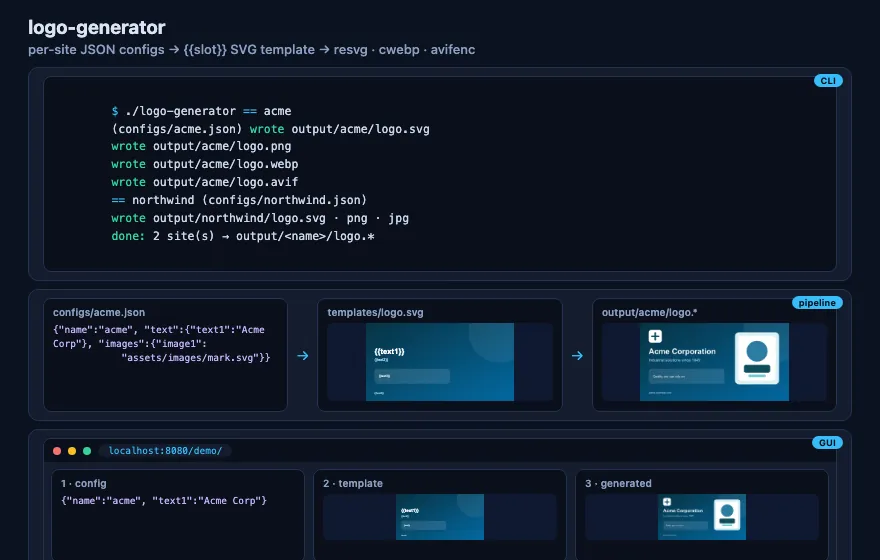

# logo-generator

[![CI][ci-badge]][ci-workflow]
[](https://www.codefactor.io/repository/github/gundestrup/logo-generator-flow)
[](https://app.codecov.io/gh/gundestrup/logo-generator-flow)
[](https://semgrep.dev/)
[](https://go.dev/)
[![Version][version-badge]][changelog]
[](LICENSE)
[](https://deepwiki.com/gundestrup/logo-generator-flow)
[](https://github.com/linebender/resvg)
[](https://developers.google.com/speed/webp)
[](https://github.com/AOMediaCodec/libavif)

[ci-badge]: https://github.com/gundestrup/logo-generator-flow/actions/workflows/ci.yml/badge.svg
[ci-workflow]: https://github.com/gundestrup/logo-generator-flow/actions/workflows/ci.yml
[version-badge]: https://img.shields.io/badge/version-0.1.1-blue.svg
[changelog]: CHANGELOG.md

CLI that renders per-site SVG logos from a shared `{{placeholder}}` template and
JSON configs, then exports raster formats with the resvg / libwebp / libavif
tools.

- `resvg` renders the filled SVG to PNG (the master raster)
- `cwebp` (libwebp) converts PNG → WebP
- `avifenc` (libavif) converts PNG → AVIF
- Go `image/jpeg` converts PNG → JPEG (optional), flattened on a background color

All raster formats derive from the same PNG, so they are pixel-identical.

<!-- markdownlint-disable MD033 -->
<picture>
  <source srcset="docs/assets/demo/logo-generator-flow.avif" type="image/avif" />
  
</picture>
<!-- markdownlint-enable MD033 -->

## Requirements

- Go 1.27.3
- `resvg`, `cwebp`, `avifenc` on PATH (or set paths per config under `tools`)

```bash
brew install resvg webp libavif   # macOS
```

Tools are only required for the formats a site requests: `resvg` for any
raster output, `cwebp` for WebP, `avifenc` for AVIF. Before rendering, each
site preflights the tools it needs; missing ones are reported together, e.g.
`missing tool(s): avifenc, resvg — install with brew install resvg webp libavif`.
The `logo.svg` is always written first, so SVG-only output works with no tools
installed.

## Usage

```bash
go build -o logo-generator .
./logo-generator                        # renders every configs/*.json
./logo-generator -configs configs       # same
./logo-generator -configs site.json     # single config file
./logo-generator -sites acme            # only matching site names
./logo-generator -out output            # output root (default: output)
./logo-generator -ui                    # browser editor → http://127.0.0.1:8181/
```

Each site writes to `output/<name>/logo.<ext>`:

```
output/acme/logo.svg
output/acme/logo.png
output/acme/logo.webp
output/acme/logo.avif
```

One failing site does not stop the others; the run exits non-zero with a
summary of failures.

## Config format

One JSON file per site in `configs/`. Relative paths (template, images,
fontFiles) resolve against the working directory.

```json
{
  "name": "acme",
  "template": "templates/logo.svg",
  "output": { "formats": ["svg", "png", "webp", "avif", "jpg"] },
  "render": {
    "width": 1600,
    "height": 0,
    "dpi": 0,
    "jpegBackground": "#ffffff",
    "jpegQuality": 92,
    "webpQuality": 90,
    "webpLossless": false,
    "avifQuality": 80,
    "avifSpeed": 6,
    "fontFamily": "",
    "fontsDir": "",
    "fontFiles": [],
    "skipSystemFonts": false
  },
  "tools": { "resvg": "", "cwebp": "", "avifenc": "" },
  "text": { "text1": "Acme Corporation", "text2": "..." },
  "images": {
    "image1": "assets/images/mark.svg",
    "image2": "assets/images/photo.png"
  }
}
```

Rules:

- `text.<textN>` may also be `{"text": "...", "color": "#rrggbb"}` —
  rendered wrapped in `<tspan fill>` so it overrides the template fill
- `images.<imageN>` may also be `{"src": "...", "fill": "#hex",
"stroke": "#hex"}` — recolors `.svg` sources (fill/stroke attrs are
  rewritten, `fill="none"` preserved, fill injected when absent);
  non-SVG sources reject fill/stroke
- `name` is required and becomes the output subdirectory
  (`[A-Za-z0-9][A-Za-z0-9_-]{0,63}`); names must be unique across configs.
- `template` is required and points at the original (unfilled) SVG template —
  per site, so different sites may use different templates.
- Text fields are fixed slots `text1`–`text6`; image fields `image1`–`image6`.
  Unused slots are simply omitted, and empty values (`"text3": ""`,
  `"image2": ""`) are accepted and render nothing. Any other key is a config
  error.
- Images are conventionally kept in `assets/images/`.
- `formats`: subset of `svg`, `png`, `webp`, `avif`, `jpg` (default: svg, png,
  webp, avif). JPEG has no alpha; transparency is flattened on
  `jpegBackground`.
- Images may be local PNG/JPEG/SVG/WebP/AVIF files or ready-made `data:` URIs.
  Remote URLs are not fetched.
- Everything under `render` and `tools` is optional; shown values are the
  defaults (empty = omit / PATH lookup).

## Template

Placeholders are `{{slot}}` in the SVG:

```svg
<image href="{{image1}}" x="70" y="55" width="105" height="105"/>
<text x="70" y="250">{{text1}}</text>
```

Text values are XML-escaped automatically; image values become base64 data
URIs. A placeholder left over after substitution fails the site with a clear
error instead of producing partial output.

## Fonts

resvg uses the system fonts by default. For reproducible output across
machines, drop font files in `assets/fonts/` — it is picked up automatically
(`--use-fonts-dir`) when no explicit `fontsDir` is set. To ignore system fonts
entirely and use only the bundled ones:

```json
"render": { "fontFamily": "Inter", "skipSystemFonts": true }
```

Alternatively, convert text to paths in the design tool before exporting the
template.

## Demo

```bash
make demo   # renders all sites, then serves the repo on :8080
```

Open <http://localhost:8080/demo/> — a three-pane view per site: the JSON
config, the raw template (placeholders visible), and the generated output
with all produced raster formats.

### Interactive editor

```bash
make edit   # ./logo-generator -ui (or -edit) → http://127.0.0.1:8181/
```

The editor is a loopback-only UI (same three-pane layout) where you can
edit a site's JSON, watch the SVG re-render live as you type, run
**render all formats** to write `output/<name>/logo.*`, and **save** the
config back to `configs/<name>.json`. No rasters are produced while
editing — preview is SVG-only, so it works even without resvg/cwebp/
avifenc installed.

A toolbar adds pickers that patch the JSON directly: **pick…** opens a
thumbnail popup of `assets/images/` for the chosen `imageN` slot (svg
files get fill + stroke color inputs and a × reset), a font dropdown lists `assets/fonts/`
(sets `render.fontFiles` + `render.fontFamily`), and a color input sets
the selected `textN` slot's `{"text", "color"}` object form.

**map template…** analyzes the configured template's `id`'d elements and
opens a modal listing each region with its bounding box; assigning a slot
per element and clicking **apply** writes `templates/<name>-filled.svg` —
figure outlines become `<image>` elements at their box geometry (aspect
preserved via `xMidYMid meet`), text elements distribute assigned slots
across their tspans. Path boxes are min/max over `d` coordinates — exact
for absolute-coordinate outlines.

## Development

```bash
make check        # version drift, gofmt, vet, lint, race tests, build
make ready        # check + frontend + deps/semgrep/vuln scans (needs network)
make frontend-check # biome lint + prettier check (npm run check)
make cover        # tests + HTML coverage report
make vuln-check   # govulncheck reachable-advisory scan
make deps-check   # list modules with updates available
make demo         # render sites + serve GUI demo on :8080
make edit         # browser editor — live config editing on :8181
make demo-media   # scripts/docs-demo.sh → docs/assets/demo/*.{png,apng,webp,avif,svg}
make install-hooks # point core.hooksPath at hooks/ — run once per clone
```

Git hooks live in `hooks/` (`pre-commit`: staged gofmt/vet/prettier/semgrep;
`pre-push`: the full gate). `SKIP_HOOKS=1` / `SEMGREP_SKIP=1` are the escape
hatches.

CI (`.github/workflows/ci.yml`) runs the same gates with every action pinned
to a commit SHA and containers digest-pinned: `make check` + svg-only smoke
test, coverage (Codecov + optional SonarCloud via `SONAR_TOKEN` — Dependabot
PRs need a Dependabot-scope secret), golangci-lint + govulncheck, semgrep,
and the frontend job (`npm ci --ignore-scripts`, biome/prettier, npm audit).
